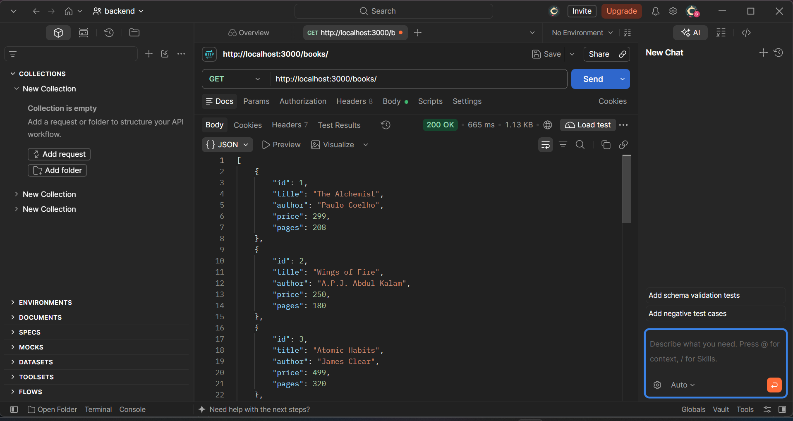
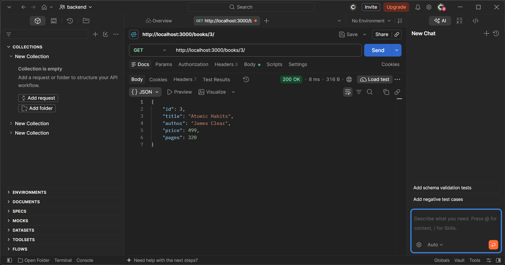
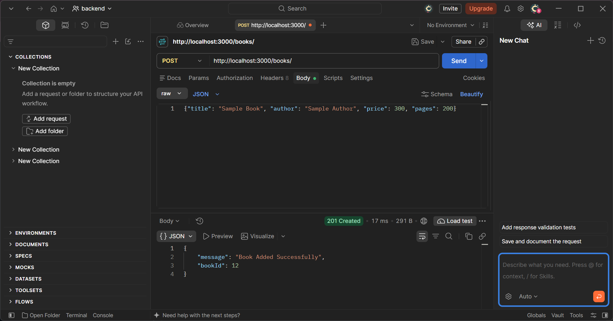
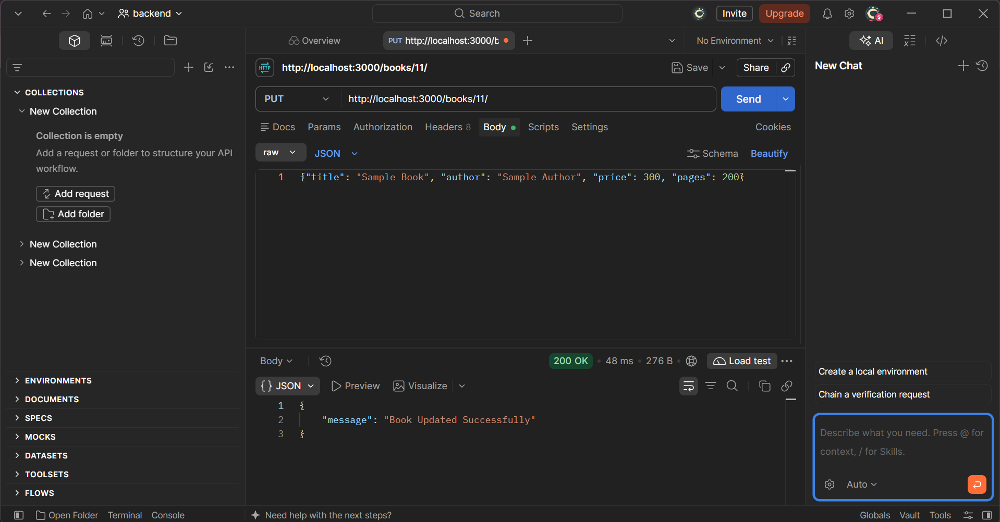
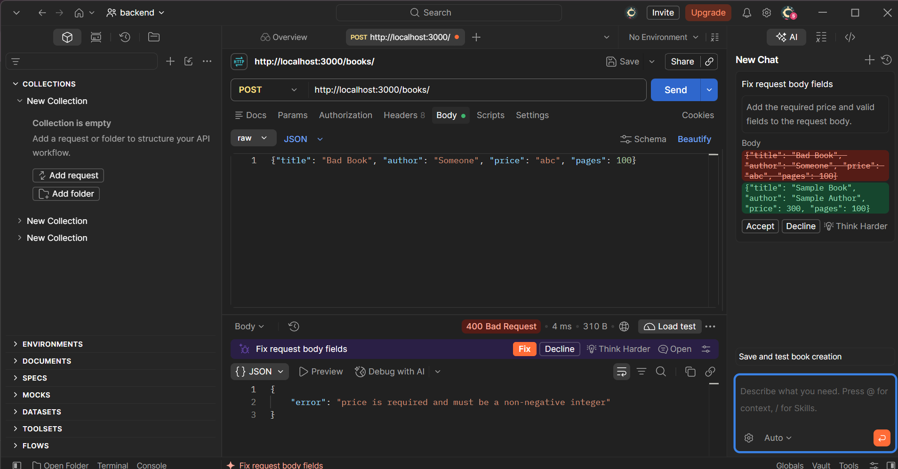
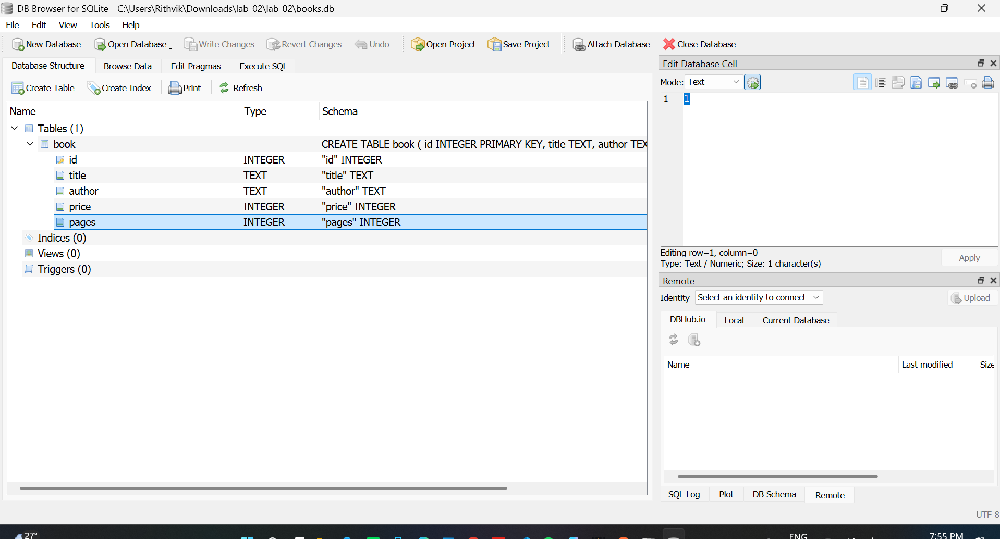

# Lab 2: SQLite database and CRUD routes

- **Name:** [Your Name]
- **Registration Number:** [Your Registration Number]
- **Section:** [Your Section]
- **Course:** Backend Development Fundamentals
- **Lab Number:** 02

## Live Link

**Deployment URL:** [YOUR_LIVE_RENDER_URL_HERE]

*(Example: `https://lab-02-sample.onrender.com/books/`)*

---

## Objective

Connect an Express server to a SQLite database and expose CRUD operations (Create, Read, Update, Delete) over HTTP. The application is configured to run locally and is fully prepared for deployment on cloud platforms like Render.

---

## Technologies Used

Node.js, Express.js, SQLite (`sqlite` + `sqlite3` packages), nodemon, Postman, Git, GitHub, Render, Visual Studio Code

---

## Project Structure

```
lab-02/
├── screenshots/
│   ├── get-all.png
│   ├── get-one.png
│   ├── post.png
│   ├── put.png
│   ├── delete.png
│   ├── post-400.png
│   └── db-view.png
├── app.js            # Express server + SQLite initialization + all routes
├── books.db          # SQLite database file (table: book, 10 rows)
├── seed.sql          # SQL used to create the table and seed initial rows
├── package.json      # Dependencies and scripts (start: "node app.js")
├── package-lock.json
├── .env.example      # Example environment variables (PORT, DB_PATH)
├── .gitignore        # Excludes node_modules, .env, and system files
└── README.md
```

---

## How to Run Locally

### Prerequisites
- Node.js (v18 or higher recommended) and npm installed.
- (Optional) SQLite CLI or DB Browser for SQLite to view database files directly.

### Steps
1. Open your terminal and navigate to the project directory:
   ```bash
   cd lab-02
   ```

2. Install dependencies:
   ```bash
   npm install
   ```

3. Start the server:
   - **Development mode** (auto-reloads on file changes using nodemon):
     ```bash
     npm run dev
     ```
   - **Standard start** (runs `node app.js`):
     ```bash
     npm start
     ```

4. The server will run at:
   ```
   http://localhost:3000/
   ```
   *(Visiting `http://localhost:3000/` will automatically redirect to `/books/`)*

---

## Environment Variables

Copy `.env.example` to `.env` to customize settings locally:
```bash
cp .env.example .env
```

| Variable | Description | Default |
| :--- | :--- | :--- |
| `PORT` | The port the HTTP server listens on | `3000` (locally) / Injected by Render in production |
| `DB_PATH` | Path to the SQLite database file | `books.db` |

> **Note:** Never commit the `.env` file to GitHub. It is ignored in `.gitignore`.

---

## Database Auto-Initialization

- If the database file (configured by `DB_PATH` or defaulting to `books.db`) does not exist, the server automatically reads `seed.sql` and initializes the table and sample records.
- If the database file already exists, it is **never overwritten** upon server restarts, preserving all added, updated, or deleted records.

### Manual Re-seeding (Optional)
To reset `books.db` to its clean seed state with the SQLite CLI:
```bash
sqlite3 books.db < seed.sql
```

---

## Endpoints

| Method | Path | Description | Success status | Error statuses |
| :--- | :--- | :--- | :--- | :--- |
| GET | `/health` | Health check endpoint for monitoring/Render | 200 OK | - |
| GET | `/` | Redirects to `/books/` | 302 Found | - |
| GET | `/books/` | Returns all books in the database | 200 OK | 500 |
| GET | `/books/:bookId/` | Returns one book by its integer ID | 200 OK | 400, 404, 500 |
| POST | `/books/` | Adds a new book (requires JSON body) | 201 Created | 400, 500 |
| PUT | `/books/:bookId/` | Updates all fields of a book by ID | 200 OK | 400, 404, 500 |
| DELETE | `/books/:bookId/` | Deletes a book by ID | 200 OK | 400, 404, 500 |

### Request Body for POST and PUT:
```json
{
  "title": "Clean Architecture",
  "author": "Robert C. Martin",
  "price": 650,
  "pages": 432
}
```

### Response Status Rules:
- `200 OK`: Request succeeded.
- `201 Created`: New book inserted successfully; returns `bookId`.
- `400 Bad Request`: Invalid ID parameter (must be positive integer), missing/invalid body fields, or malformed JSON.
- `404 Not Found`: No book found with the given ID, or route does not exist.
- `500 Internal Server Error`: Server or database failure.
- All SQL queries use parameter placeholders (`?`) to prevent SQL injection.

---

## Deployment Instructions

### 1. Push to GitHub

1. Ensure sensitive files and dependencies are ignored (verified in `.gitignore`):
   - `node_modules/` is excluded.
   - `.env` is excluded.

2. In your terminal inside the project directory:
   ```bash
   git init
   git add .
   git commit -m "Initial commit - Lab 2 Express SQLite CRUD API"
   ```

3. Create a new repository on [GitHub](https://github.com/new).

4. Link and push your code:
   ```bash
   git branch -M main
   git remote add origin https://github.com/<your-username>/<your-repo-name>.git
   git push -u origin main
   ```

---

### 2. Deploy to Render

1. Log in to [Render](https://render.com/).
2. On the Dashboard, click **New +** and select **Web Service**.
3. Choose **Build and deploy from a Git repository** and connect your GitHub repository.
4. Fill in the deployment settings:
   - **Name:** `lab-02-crud` (or your preferred name)
   - **Language / Environment:** `Node`
   - **Branch:** `main`
   - **Root Directory:** If your repository has `lab-02` as a subfolder, set Root Directory to `lab-02`. Otherwise, leave blank (`.`).
   - **Build Command:** `npm install`
   - **Start Command:** `npm start`
   - **Instance Type:** `Free`
5. *(Optional)* Under **Advanced**:
   - **Health Check Path:** `/health`
   - **Environment Variables**:
     - `NODE_ENV`: `production`
     - `PORT`: (Provided automatically by Render)
     - `DB_PATH`: `books.db` (optional)
6. Click **Deploy Web Service**.
7. Once deployed, Render will provide a live URL (e.g. `https://lab-02-xxxx.onrender.com`).
8. Verify your deployment:
   - Visit `https://<your-service-name>.onrender.com/health` (should return `{"status":"ok",...}`)
   - Visit `https://<your-service-name>.onrender.com/books/` (should display the 10 books)
9. Update the **Deployment URL** at the top of this `README.md` with your live link.

---

## Screenshots

Postman screenshots of each endpoint, plus the database view:

### GET all books


### GET one book


### POST add a book (201)


### PUT update a book


### DELETE remove a book


### Invalid input (400)


### SQLite database (DB Browser for SQLite)


---

## Viva Questions

### 1. Why `await` the database call?
Database calls are asynchronous I/O operations that return a Promise. Using `await` pauses execution of that async function until the Promise resolves, ensuring the server uses real data rather than an unresolved Promise object. It also guarantees that the database connection is established before the Express server begins listening for requests.

### 2. What is SQL injection and how do placeholders prevent it?
SQL injection occurs when untrusted user input is directly concatenated into a SQL statement (e.g., `1 OR 1=1`), altering query logic. By using parameterized queries with `?` placeholders, the SQL statement structure is pre-compiled, and user inputs are sent separately strictly as data parameters, making SQL injection impossible.

### 3. When is PUT used instead of POST?
- `POST` is used to create a new resource where the server determines the identifier (e.g. `POST /books/`).
- `PUT` is used to replace or update an existing resource at a known URI (e.g. `PUT /books/:bookId/`).

---

## Notes: Problems Faced and Solutions

- **SQLite CLI missing locally:** Viewed and managed `books.db` with DB Browser for SQLite.
- **Port flexibility:** Updated server to use `process.env.PORT || 3000` so cloud platforms like Render can bind dynamically without port conflicts.
- **Ephemeral filesystem on cloud hosting:** On free cloud tiers (like Render), files modified during runtime reset when the service spins down or restarts. The automatic database initialization from `seed.sql` ensures the database is automatically restored if the file is recreated on a fresh spin-up.
